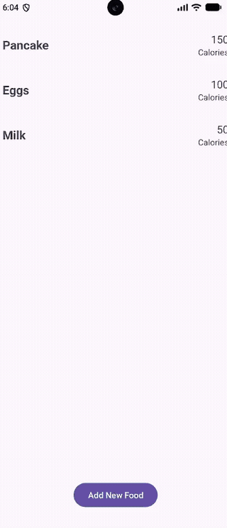

# Android Project 5 - *BitFit Part 1*

Submitted by: **Daniel Emerle**

**BitFit** is a health metrics app that allows users to track **the foods they eat and the calories of each food item**. The user can add food entries (name + calories) through a simple dialog, and every entry is saved to a local Room database so their food list is always there when they reopen the app — even with no internet connection.

Time spent: **4** hours spent in total

## Required Features

The following **required** functionality is completed:

- [x] **At least one health metric is tracked (based on user input)**
  - Chosen metric(s): **Nutrition / Calories** — the user logs each food they eat along with its calorie count
- [x] **There is a "create entry" UI that prompts users to make their daily entry**
- [x] **New entries are saved in a database and then updated in the RecyclerView**
- [x] **On application restart, previously entered entries are preserved (i.e., are *persistent*)**

The following **optional** features are implemented:

- [ ] **Create a UI for tracking averages and trends in metrics**
- [ ] **Improve and customize the user interface through styling and coloring**
- [ ] **Implement orientation responsivity**
- [ ] **Add a daily photo feature**

The following **additional** features are implemented:

- [ ] List anything else that you can get done to improve the app functionality!

## Video Walkthrough

Here's a walkthrough of implemented user stories:

GIF created with **ffmpeg** (cropped the screen recording to the emulator and converted to GIF).

## Notes

Challenges encountered while building the app:
- Creating a dialog to add food was easy with all the AlertDialog documentation
- Google's docs were interesting, to say the least...

Biggest Issue: Dependencies
- The project was created with the latest AGP / Gradle versions, which use AGP's new **built-in Kotlin** support (no separate `kotlin-android` plugin).
- Since our compileSdk was so new, there were some agonizing dependency issues when trying to add Room to the project. To resolve this, we used the newest available Room dependency alongside the matching KSP version, and added the KSP plugin to our `app/build.gradle.kts` so Room's annotations could be processed at compile time.

## License

    Copyright [2026] [Daniel Emerle]

    Licensed under the Apache License, Version 2.0 (the "License");
    you may not use this file except in compliance with the License.
    You may obtain a copy of the License at

        http://www.apache.org/licenses/LICENSE-2.0

    Unless required by applicable law or agreed to in writing, software
    distributed under the License is distributed on an "AS IS" BASIS,
    WITHOUT WARRANTIES OR CONDITIONS OF ANY KIND, either express or implied.
    See the License for the specific language governing permissions and
    limitations under the License.
